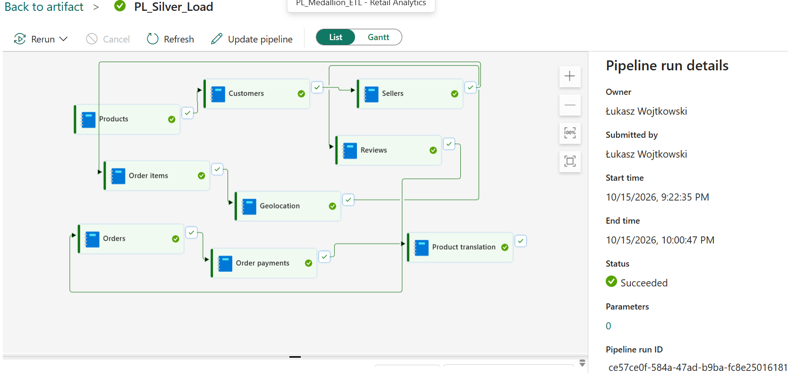
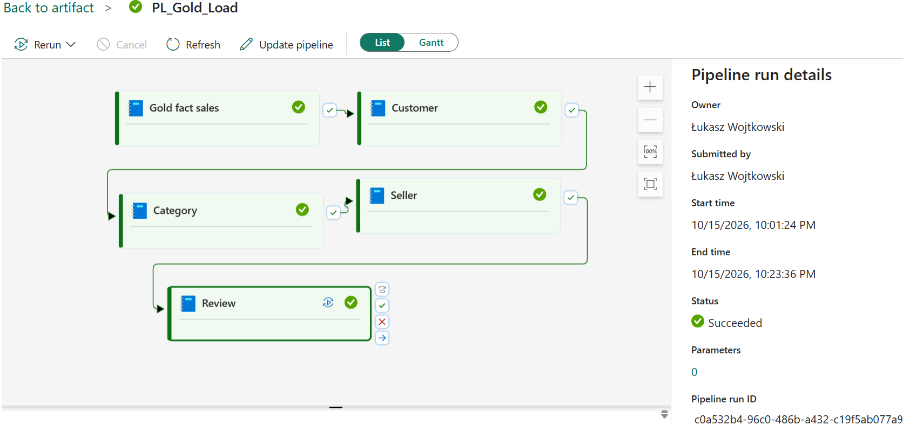
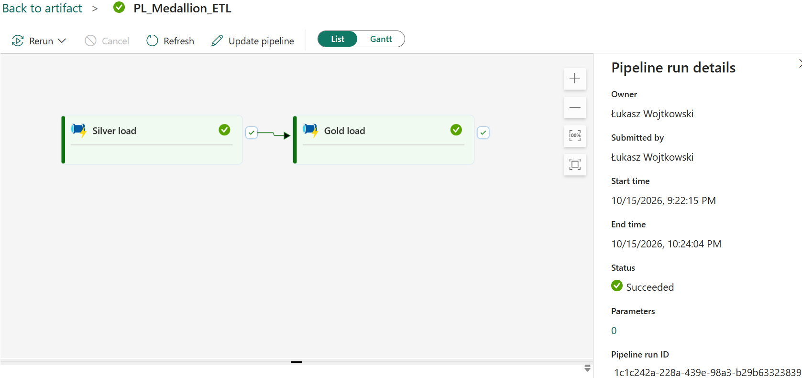

# Fabric Retail Analytics

My first end-to-end Microsoft Fabric Data Engineering project.

The goal of this project is to learn and apply modern Data Engineering concepts using Microsoft Fabric, including Lakehouse architecture, PySpark transformations, Medallion Architecture, Data Pipelines and Power BI.

The solution processes raw e-commerce data through Bronze, Silver and Gold layers and prepares analytical datasets for reporting and business intelligence.

## Dataset

This project uses the Olist Brazilian E-Commerce Public Dataset, a publicly available e-commerce dataset containing information about:

- Orders
- Customers
- Products
- Sellers
- Payments
- Reviews
- Geolocation data

Source: Kaggle Olist Dataset.

## Architecture

The solution follows the Medallion Architecture pattern:

```text
CSV Files (Manual Load)
    ↓
Bronze Layer
    ↓
Silver Layer
    ↓
Gold Layer
    ↓
Power BI
```

### Bronze Layer

The Bronze layer contains raw data manually loaded from CSV files into the Fabric Lakehouse.

### Silver Layer

The Silver layer performs cleansing, standardization and entity-level transformations.

Implemented transformations:

- Orders
- Order Items
- Products
- Customers
- Geolocation
- Order Payments
- Sellers
- Product Translation
- Order Reviews

### Gold Layer

The Gold layer contains business-oriented analytical models.

Implemented datasets:

- Sales Fact Table
- Customer Metrics
- Seller Metrics
- Category Metrics
- Review Metrics

## Project Structure

```text
fabric-retail-analytics
│
├── notebooks
│   ├── silver
│   └── gold
│
├── pipelines
│   ├── silver_pipeline.json
│   ├── gold_pipeline.json
│   └── medallion_pipeline.json
│
├── powerbi
│
├── images
│
└── README.md
```

## Data Pipelines

### Silver Pipeline

The Silver pipeline orchestrates Bronze-to-Silver transformations using Microsoft Fabric Data Pipelines.



### Gold Pipeline

The Gold pipeline builds analytical datasets from the sales fact table and creates business metrics.



### End-to-End Medallion Pipeline

The Medallion pipeline orchestrates the complete transformation workflow from Bronze-layer data to Gold analytical models.



## Implementation Challenge

### Working Within Trial Capacity Constraints

During development, the original design executed multiple notebooks in parallel.

Because the project was developed using a Microsoft Fabric trial environment with limited Spark resources, pipeline executions occasionally failed due to insufficient capacity available for concurrent notebook execution.

To ensure reliable execution, pipeline dependencies were redesigned and notebook execution was moved to a controlled sequential flow using **On Success** dependencies.

Although some transformations could technically run in parallel, the final orchestration prioritizes stability and successful end-to-end execution within the constraints of the trial environment.

This approach allowed the complete Medallion pipeline to execute successfully from start to finish.

## Technologies Used

- Microsoft Fabric
- Lakehouse
- PySpark
- Data Pipelines
- Medallion Architecture
- Python
- Git
- GitHub
- Power BI

## Future Improvements

- Power BI Semantic Model
- Retail Analytics Dashboard
- Incremental Data Loading
- Data Quality Monitoring
- CI/CD Integration